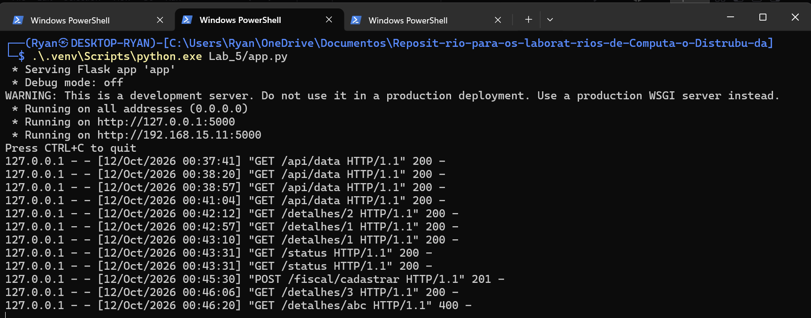
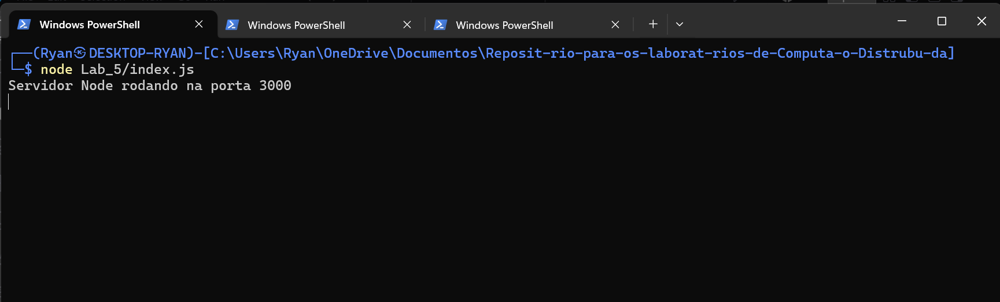
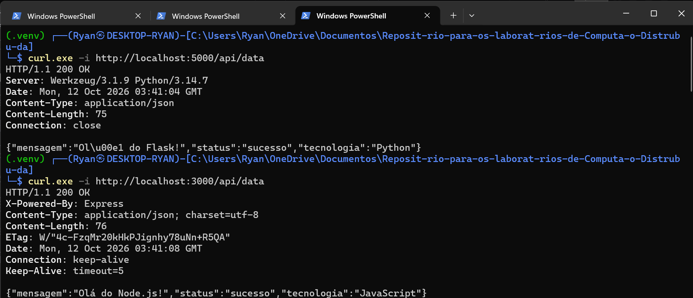
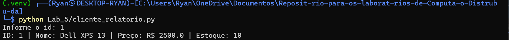
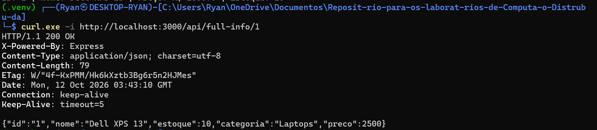
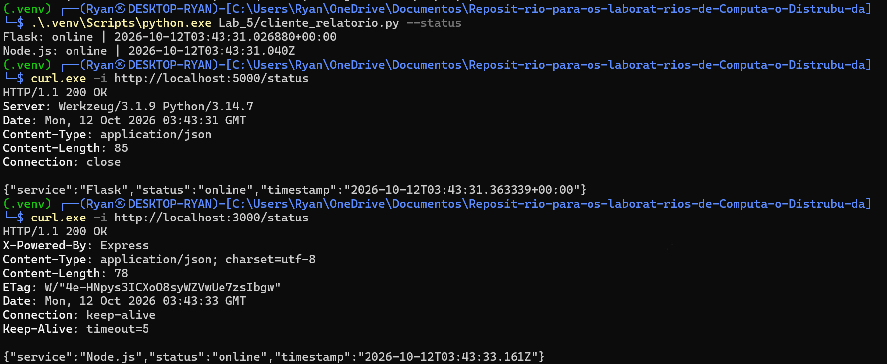
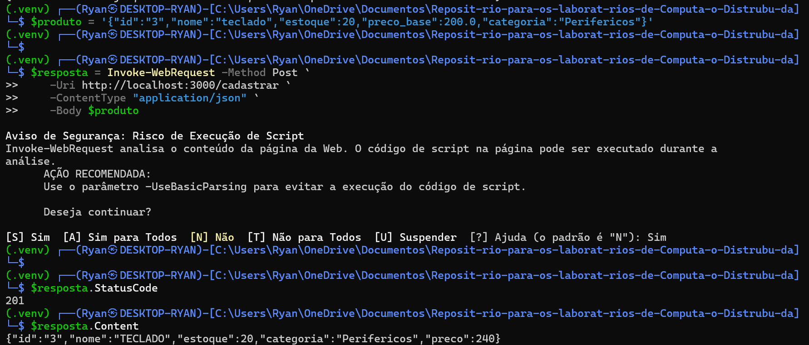
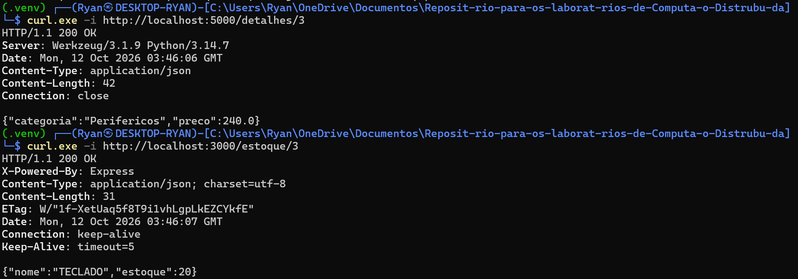
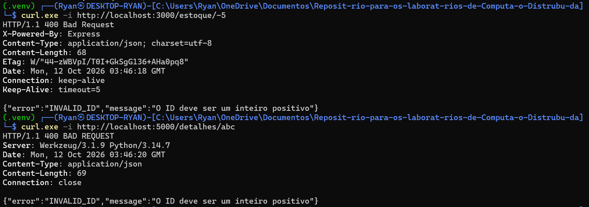

# Integração de Web Services com Flask e Node.js

**Laboratório 5 - Python + JavaScript + HTTP/JSON**

| Identificação | Informação |
|---|---|
| Instituição | Universidade Presbiteriana Mackenzie - Faculdade de Computação e Informática |
| Curso | Ciência da Computação |
| Disciplina | Computação Distribuída |
| Aluno | Ryan Ledo |
| RA | 10352727 |
| Turma | 06N |
| Professor | Prof. Mário |

## 1. Introdução e Fundamentos Teóricos

O objetivo deste laboratório é integrar dois serviços escritos em linguagens diferentes.
O Flask mantém os dados fiscais, enquanto o Node.js mantém nome e estoque dos produtos.
A comunicação utiliza HTTP e representações JSON, permitindo que um cliente Python
consulte os dois serviços e consolide os dados sem depender da linguagem de implementação.
GET consulta os recursos e POST realiza o cadastro. Cada requisição fornece as informações
necessárias ao processamento. O estado dos produtos permanece nos dicionários dos serviços.

## 2. Metodologia e Ambiente de Execução

Os serviços foram executados como processos locais no Windows, nas portas 5000 e 3000.
Não foram utilizados Docker, MPI ou máquinas físicas distintas neste laboratório.
O ambiente registrado utiliza Python 3.14.7, Node v24.19.0,
Flask 3.1.3 e requests 2.34.2. O registro temporal da bateria
é 2026-10-11T00:30:42.147679-03:00. Esse registro vem do ambiente de execução.

O script executar_experimentos.py iniciou os dois processos, aguardou as rotas de status,
executou requisições HTTP reais e encerrou somente os processos que havia iniciado.
As respostas foram verificadas por asserções e salvas em evidencias/execucoes.json e
evidencias/execucoes.txt. Cinco execuções do cliente foram registradas em evidencias/cliente.txt.

### 2.1 Arquitetura e armazenamento

No exercício 1, o cliente consulta Flask e Node diretamente. No exercício 2, o Node atua
como cliente do Flask e devolve uma representação consolidada. No exercício 4, o Node
valida e transforma o nome, encaminha os dados fiscais e salva o estoque apenas após HTTP 201.
produtos_tecnicos é um alias de produtos_fiscais, e produtos_comerciais é um alias de
produtos_estoque. Assim, os cadastros continuam disponíveis nas rotas de consulta.
O armazenamento solicitado é em memória: reiniciar os processos remove os cadastros.

## 3. Evidências Experimentais

As capturas fornecidas pelo aluno registram a execução individual dos exemplos e
dos cinco exercícios em 12/10/2026. Elas complementam os registros da bateria
automatizada de 11/10/2026. Os horários dos cabeçalhos HTTP estão em GMT/UTC,
enquanto os logs do Flask exibem o horário local.

### 3.1 Inicialização dos serviços e exemplos da aula

**Figura 1 — Serviço Flask ativo na porta 5000 e logs das requisições dos exercícios.**



**Figura 2 — Inicialização do serviço Node.js na porta 3000.**



**Figura 3 — Exemplos da aula: respostas HTTP 200 das rotas /api/data no Flask e no Node.**



### 3.2 Registros reais das execuções automatizadas

As saídas abaixo foram obtidas pelo cliente durante a bateria, sem valores simulados.

```text
$ python cliente_relatorio.py 
Informe o id: ID: 1 | Nome: Dell XPS 13 | Preço: R$ 2500.0 | Estoque: 10

$ python cliente_relatorio.py --id 2
ID: 2 | Nome: Monitor LG 29 | Preço: R$ 1200.0 | Estoque: 5

$ python cliente_relatorio.py --id 3
ID: 3 | Nome: TECLADO | Preço: R$ 240.0 | Estoque: 20

$ python cliente_relatorio.py --status
Flask: online | 2026-10-11T03:30:39.567109+00:00
Node.js: online | 2026-10-11T03:30:39.571Z

$ python cliente_relatorio.py --id -5
Erro HTTP 400: {"error":"INVALID_ID","message":"O ID deve ser um inteiro positivo"}
```


## 4. Resultados das Verificações HTTP

Foram aprovadas 39 verificações HTTP e cinco execuções do cliente.
O laboratório não exige comparação de desempenho; por isso, a tabela registra os
códigos HTTP observados, sem inferir latência ou speedup.

| Caso | Requisição local | HTTP |
|---|---|---:|
| Exemplo da aula | GET 5000/api/data | 200 |
| Exemplo da aula | GET 3000/api/data | 200 |
| Exercício 1 - fiscal | GET 5000/detalhes/1 | 200 |
| Exercício 1 - estoque | GET 3000/estoque/1 | 200 |
| Exercício 2 - proxy | GET 3000/api/full-info/1 | 200 |
| Exercício 1 - fiscal | GET 5000/detalhes/2 | 200 |
| Exercício 1 - estoque | GET 3000/estoque/2 | 200 |
| Exercício 2 - proxy | GET 3000/api/full-info/2 | 200 |
| Exercício 3 - status | GET 5000/status | 200 |
| Exercício 3 - status | GET 3000/status | 200 |
| Exercício 4 - cadastro distribuído | POST 3000/cadastrar | 201 |
| Exercício 4 - consulta fiscal | GET 5000/detalhes/3 | 200 |
| Exercício 4 - consulta comercial | GET 3000/estoque/3 | 200 |
| Exercício 4 - consulta integrada | GET 3000/api/full-info/3 | 200 |
| Cadastro duplicado | POST 3000/cadastrar | 409 |
| Exercício 5 - ID inválido | GET 5000/detalhes/-5 | 400 |
| Exercício 5 - ID inválido | GET 5000/detalhes/abc | 400 |
| Exercício 5 - ID inválido | GET 5000/detalhes/0 | 400 |
| Exercício 5 - ID inválido | GET 5000/detalhes/1.5 | 400 |
| Produto ausente | GET 5000/detalhes/999 | 404 |
| Exercício 5 - ID inválido | GET 3000/estoque/-5 | 400 |
| Exercício 5 - ID inválido | GET 3000/estoque/abc | 400 |
| Exercício 5 - ID inválido | GET 3000/estoque/0 | 400 |
| Exercício 5 - ID inválido | GET 3000/estoque/1.5 | 400 |
| Produto ausente | GET 3000/estoque/999 | 404 |
| Exercício 5 - ID inválido | GET 3000/api/full-info/-5 | 400 |
| Exercício 5 - ID inválido | GET 3000/api/full-info/abc | 400 |
| Exercício 5 - ID inválido | GET 3000/api/full-info/0 | 400 |
| Exercício 5 - ID inválido | GET 3000/api/full-info/1.5 | 400 |
| Produto ausente | GET 3000/api/full-info/999 | 404 |
| Dados inválidos | POST 5000/fiscal/cadastrar | 400 |
| JSON malformado | POST 5000/fiscal/cadastrar | 400 |
| Dados inválidos | POST 3000/cadastrar | 400 |
| JSON malformado | POST 3000/cadastrar | 400 |
| Cadastro fiscal direto | POST 5000/fiscal/cadastrar | 201 |
| Arredondamento monetário | GET 5000/detalhes/5 | 200 |
| Proxy com Flask desligado | GET 3000/api/full-info/1 | 502 |
| Cadastro com Flask desligado | POST 3000/cadastrar | 502 |
| Sem gravação comercial na falha | GET 3000/estoque/4 | 404 |

## 5. Análise dos Cinco Exercícios

### 5.1 Cliente integrador

O cliente solicita o ID e utiliza requests para buscar /detalhes/<id> e /estoque/:id.
Os dicionários são fundidos e impressos no formato solicitado. Para o ID 1, a execução
mostrou Dell XPS 13, preço 2500.0 e estoque 10. O ID 2 também foi consultado.

**Figura 4 — Cliente integrador: entrada do ID 1 e relatório com nome, preço e estoque.**



### 5.2 Comunicação Server-to-Server

A rota /api/full-info/:id usa fetch nativo do Node para consultar o Flask.
As respostas integradas dos IDs 1 e 2 foram comparadas aos dados das consultas individuais.
O cadastro de ID 3 também ficou acessível nessa rota. Com o Flask desligado, o proxy
retornou HTTP 502, em vez de causar erro não tratado.

**Figura 5 — Consulta /api/full-info/1 ao Node, retornando os dados comerciais e fiscais com HTTP 200.**



### 5.3 Padronização de contrato

Ambos os serviços retornaram as mesmas chaves: service, status e timestamp.
O status foi online e os timestamps puderam ser interpretados como datas ISO 8601.
Os valores de service identificam cada servidor e os horários podem diferir.
A função consultar_status recebe uma lista de URLs e usa o mesmo processamento para todas.

**Figura 6 — Cliente genérico de monitoramento e respostas /status dos dois serviços.**



### 5.4 Cadastro completo

O POST /cadastrar recebeu o ID 3, nome teclado, estoque 20, preço base 200.0 e categoria
Perifericos. O Node converteu o nome em TECLADO e encaminhou os dados fiscais ao Flask.
O Flask aplicou 20% e persistiu preço 240.0. A resposta do Node foi HTTP 201.
As consultas posteriores confirmaram a gravação em ambos os serviços. Também foi verificado
o arredondamento monetário: preço base 100.01 resultou em 120.01.

O fluxo não constitui uma transação distribuída atômica. Se o Flask gravar e sua resposta
se perder, ou o Node encerrar antes de gravar, pode existir apenas o registro fiscal.
Não há rollback automático. A bateria verificou falha com o Flask já desligado:
o cadastro retornou 502 e nenhum estoque para o ID 4 foi criado.

**Figura 7 — Cadastro do ID 3: entrada completa, HTTP 201 e resposta com TECLADO e preço 240.**



**Figura 8 — Consultas após o cadastro: preço fiscal 240.0 no Flask e nome TECLADO com estoque 20 no Node.**



### 5.5 Protocolo de erro e validação

As três rotas de consulta por ID rejeitaram -5, abc, 0 e 1.5 com HTTP 400.
O corpo foi idêntico: error INVALID_ID e message O ID deve ser um inteiro positivo.
IDs positivos não cadastrados retornaram 404. Cadastros duplicados retornaram 409.
Preço negativo e JSON malformado retornaram 400. Os testes confirmaram o protocolo
exigido no enunciado e o tratamento de falhas adicionais na integração.

**Figura 9 — ID negativo no Node e ID não numérico no Flask: HTTP 400 e mensagem INVALID_ID.**



## 6. Dificuldades Técnicas e Soluções

O cliente inicial tentava acessar mensagem e tecnologia nos dados fiscais, enquanto
o cadastro exigia outros campos. A solução foi separar a rota do exemplo /api/data
das rotas de produtos e fundir as respostas adequadas no cliente.
O servidor Node inicial não possuía a base de estoque nem dependência Express declarada.
Foram adicionados o estoque inicial, as rotas e a dependência com package-lock.json.
Chamadas remotas usam timeout de cinco segundos e tratamento de erros.
Um conjunto de IDs pendentes evita dois cadastros simultâneos do mesmo ID no Node.

## 7. Declaração e Análise do Uso de IA

Foi utilizado o chatgpt para esclarecer dúvidas acerca do guia dos exercícios
e auxiliar na depuração do código desenvolvido. Também foi utilizado para
auxiliar no desenvolvimento do relatório, foi pedido para corrigir erros de 
sintaxe de português e inicialmente um sumário para nortear a escrita do relatório.

## 8. Conclusão e Referências

Os cinco exercícios foram implementados e verificados por comunicação HTTP real.
Os testes confirmaram a integração entre linguagens, a composição das respostas,
a aplicação do imposto e o contrato de erro. A persistência é restrita à memória,
e o cadastro distribuído não possui garantia de atomicidade. O código e os registros
estão acompanhados das nove capturas de tela dos exemplos e dos exercícios,
organizadas nas seções correspondentes deste relatório.

1. MATERIAL DIDÁTICO DA DISCIPLINA. Laboratório Web Service - Computação Distribuída.
Prof. Alcides/Mário. Arquivo Aula12IntroWS.pdf, páginas 1 a 7.
2. MODELOS FORNECIDOS. Relatórios dos laboratórios 3 e 4 deste repositório.
