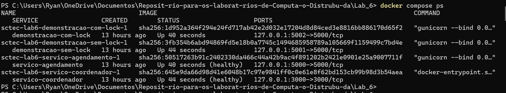
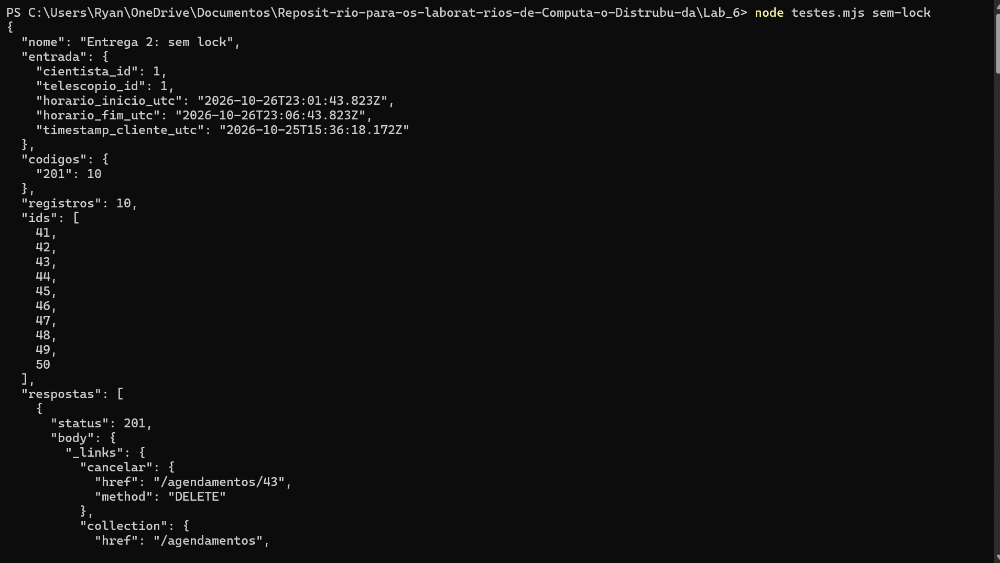

# Web Services e Containers: Controle de Telescópio Espacial Compartilhado

**Laboratório 6 - SCTEC / Flask + Node.js + Docker**

| Identificação | Informação |
|---|---|
| Projeto | Sistema de Controle de Telescópio Espacial Compartilhado |
| Disciplina | Computação Distribuída |
| Instituição | Universidade Presbiteriana Mackenzie |
| Professores do enunciado | Prof. Alcides / Prof. Mário |
| Nome | Ryan Ledo |
| RA | 10352727 |
| Data do relatório | 25/10/2026 |

## 1. Introdução e Fundamentação Teórica

### 1.1 Objetivo

O laboratório implementa o núcleo de agendamento de um telescópio compartilhado. A atividade foi organizada nas cinco entregas do enunciado: contrato REST, demonstração de condição de corrida, coordenador de exclusão mútua, sincronização do cliente e orquestração com Docker.

### 1.2 REST e HATEOAS

A API identifica cientistas, telescópios e agendamentos por recursos HTTP. GET consulta, POST cria e DELETE cancela uma reserva. As representações JSON incluem links com endereço e método. O cliente usa o link cancelar recebido do servidor; quando a reserva está cancelada, esse link deixa de existir. O histórico permanece disponível para consulta.

### 1.3 Exclusão mútua e condição de corrida

Verificar disponibilidade e inserir uma reserva são duas operações que precisam ser protegidas em conjunto. Sem coordenação, vários clientes podem ler o mesmo horário livre antes de qualquer gravação. O coordenador Express concede acesso a um único solicitante e responde 409 aos concorrentes. A liberação ocorre em finally, inclusive quando a validação ou a operação no banco falha.

### 1.4 Tempo e auditoria

O cliente estima o tempo do servidor pelo algoritmo de Cristian: soma metade do RTT ao instante recebido em GET /time. São feitas cinco amostras e escolhida a de menor RTT. A estimativa não elimina assimetria de rede nem estabelece uma fila justa de cliques. O timestamp do cliente fica registrado, mas o vencedor é quem adquire o lock. A auditoria associa as alterações persistidas ao cientista informado, ao telescópio, ao intervalo e ao instante UTC do servidor.

<!-- nova-pagina -->

## 2. Ambiente e Organização

### 2.1 Ambiente observado

| Componente | Versão ou configuração observada |
|---|---|
| Docker Engine | 29.7.2, contexto desktop-linux |
| Python no container | 3.12.15 |
| Node.js no coordenador | 22.23.4 |
| Node.js no host | 24.19.0 |
| Flask / Flask-SQLAlchemy | 3.1.2 / 3.1.1 |
| SQLAlchemy / SQLite | SQLAlchemy 2.1.6; banco SQLite em volume Docker |
| Express | 5.1.0, dependências registradas em package-lock.json |
| Servidor HTTP Python | Gunicorn 23.0.0; um worker e vinte threads |

A lista completa das bibliotecas Python executadas foi salva em evidencias/requirements-executados.txt. O Python disponível pelo alias do Windows não iniciou; a execução foi realizada nos containers. O Docker Desktop estava parado no início e foi iniciado antes dos experimentos.

### 2.2 Serviços e isolamento

| Serviço | Finalidade e acesso local |
|---|---|
| servico-agendamento | Aplicação padrão com lock, porta 5000 |
| servico-coordenador | Lock/unlock em memória, porta 3000 |
| demonstracao-sem-lock | Entrega 2, banco separado, porta 5001 |
| demonstracao-com-lock | Entrega 3, banco separado, porta 5002 |

As demonstrações são ativadas pelo perfil experimentos e possuem pausa artificial de um segundo entre verificação e escrita. Essa pausa amplia a janela de disputa e não faz parte da aplicação padrão. Cada banco usa um volume próprio. As portas são publicadas em 127.0.0.1; o Flask encontra o Node pelo nome de serviço na rede do Compose.

### 2.3 Organização dos entregáveis

MODELOS.md define entidades e invariantes; API.md define endpoints e respostas; LOGGING.md define os registros. Os diretórios servico-agendamento e servico-coordenador contêm código, dependências e Dockerfiles. testes.mjs executa os experimentos e coleta evidências. O relatório editável é relatorio.md; gerar_relatorio.py lê esse arquivo e produz o PDF sem reescrever o Markdown.

<!-- nova-pagina -->

## 3. Implementação das Entregas

### 3.1 Entrega 1 - Blueprint da API

Foram modelados Cientista, Telescópio, Agendamento e Auditoria. Datas com fuso são normalizadas para UTC com milissegundos. O intervalo deve ter fim posterior ao início. Reservas ativas entram em conflito quando pertencem ao mesmo telescópio e seus intervalos se sobrepõem. Intervalos adjacentes são permitidos. As respostas expõem links self, collection e, quando aplicável, cancelar.

### 3.2 Entrega 2 - Sistema inicial e prova da falha

O mesmo serviço Flask pode iniciar com LOCK_ENABLED=false em ambiente isolado. Nesse modo, a leitura termina antes da escrita e não há transação abrangendo a checagem e a inserção. Dez chamadas HTTP são disparadas concorrentemente pelo script. Cada sucesso registra um agendamento e um evento AGENDAMENTO_CRIADO. O resultado é comparado com a consulta efetiva do banco, sem substituir resultado observado por previsão.

### 3.3 Entrega 3 - Coordenador

POST /lock recebe um recurso e devolve um token se estiver livre; se ocupado, retorna 409. POST /unlock exige o mesmo recurso e seu token. O mapa em memória é atualizado sincronamente pelo processo Node, sem espera assíncrona entre consulta e inserção.

A chave escolhida é telescopio-{id}. Essa escolha também protege intervalos parcialmente sobrepostos, que poderiam escapar de uma chave formada apenas pelo horário inicial. No Flask, BEGIN IMMEDIATE engloba checagem, escrita e auditoria; é uma segunda proteção persistente, com o custo de serializar escritas no SQLite. Falha do coordenador resulta em 503, sem prosseguir para a reserva.

### 3.4 Entrega 4 - Cliente e cancelamento

GET /time retorna UTC e milissegundos Unix, sem cache. O cliente calcula a compensação a partir de cinco amostras e avança o relógio usando performance.now(). Antes de reservar, sincroniza novamente. O formulário converte os horários locais para UTC. O cancelamento segue o endereço e o método de _links.cancelar. A primeira transição gera AGENDAMENTO_CANCELADO; repetições não duplicam o evento.

### 3.5 Entrega 5 - Docker e logs agregados

Os dois serviços principais possuem Dockerfiles e são conectados pelo docker-compose.yml. O healthcheck do coordenador antecede a inicialização do serviço de agendamento. O Flask escreve no console e em app.log; o Node escreve JSON no console. docker compose logs reúne os dois fluxos, mantendo o nome do serviço de origem. Os eventos de auditoria também ficam na mesma transação de banco da alteração correspondente.

<!-- nova-pagina -->

## 4. Execução e Evidências

### 4.1 Origem das evidências e ambiente

Esta seção utiliza a transcrição do meu terminal, com testes realizados em 25/10/2026, entre (12:39 a 12:44). A transcrição integral foi preservada em [terminal-usuario-2026-10-25.txt](evidencias/terminal-usuario-2026-10-25.txt); os sete objetos JSON de resultados foram extraídos, sem alterar valores, para [resultados-usuario-2026-10-25.json](evidencias/resultados-usuario-2026-10-25.json).

OBS: Os prints não pegam toda a saída, exige diversos prints e fica confuso. Por isso, irei deixar a saída do terminal. 

Para manter a leitura, os blocos abaixo selecionam os campos relevantes e identificam os recortes dos logs. As dez respostas individuais completas, os prompts e as linhas repetidas permanecem na transcrição integral.



Figura 1 - Captura de ambiente.

As evidências anteriores em testes-todos.json e nos extratos de banco permanecem arquivadas. Seus IDs, horários e totais históricos não são os da rodada transcrita aqui. Os resultados desta seção se referem aos intervalos explicitamente indicados, não ao total acumulado dos volumes.

### 4.2 Condição de corrida e exclusão mútua

| Cenário | HTTP 201 / HTTP 409 | Registros no intervalo |
|---|---|---|
| Demonstração sem lock | 10 / 0 | 10, IDs 51 a 60 |
| Demonstração com lock | 1 / 9 | 1, ID 4 |
| Aplicação padrão, sem pausa | 1 / 9 | 1, ID 9 |



A captura acima registra uma execução anterior, com IDs 41 a 50. Ela foi preservada como evidência complementar; a transcrição abaixo corresponde à nova execução, com IDs 51 a 60. Os resultados das duas rodadas não devem ser misturados.

Figura 2 - Captura de execução.

### 4.2.1 Entrega 2 - Saída do teste sem lock

Comando executado: node testes.mjs sem-lock. Recorte do JSON retornado, omitindo apenas a lista repetitiva respostas:

```json
{
  "nome": "Entrega 2: sem lock",
  "entrada": {
    "cientista_id": 1,
    "telescopio_id": 1,
    "horario_inicio_utc": "2026-10-27T00:06:43.823Z",
    "horario_fim_utc": "2026-10-27T00:11:43.823Z",
    "timestamp_cliente_utc": "2026-10-25T15:39:09.244Z"
  },
  "codigos": {
    "201": 10
  },
  "registros": 10,
  "ids": [
    51,
    52,
    53,
    54,
    55,
    56,
    57,
    58,
    59,
    60
  ]
}
```

O resumo PowerShell registrou executado_em_utc=2026-10-25T15:39:09.193Z e aprovado=True. A consulta direta ao SQLite confirmou o início, a quantidade e os IDs:

```text
[('2026-10-27T00:06:43.823Z', 10, '51,52,53,54,55,56,57,58,59,60')]
```

Os dez registros ocupam o mesmo intervalo. A lista de respostas no anexo contém dez HTTP 201, confirmando a condição de corrida.

### 4.2.2 Entrega 2 - Logs e auditoria

Comando executado: docker compose logs --since 1m --no-color demonstracao-sem-lock. Foram contadas dez verificações, dez gravações e dez eventos AGENDAMENTO_CRIADO no trecho fornecido. Recorte literal com duas verificações e a primeira gravação:

```text
demonstracao-sem-lock-1  | 2026-10-25 15:39:09,265Z INFO servico-agendamento Iniciando verificacao de conflito no BD: telescopio-1 2026-10-27T00:06:43.823Z
demonstracao-sem-lock-1  | 2026-10-25 15:39:09,269Z INFO servico-agendamento Iniciando verificacao de conflito no BD: telescopio-1 2026-10-27T00:06:43.823Z
demonstracao-sem-lock-1  | 2026-10-25 15:39:10,271Z INFO servico-agendamento Salvando novo agendamento no BD: telescopio-1 2026-10-27T00:06:43.823Z
```

As verificações acima ocorreram antes da primeira escrita. A pausa de um segundo amplia a janela de disputa. Dois eventos do mesmo intervalo, extraídos das linhas de auditoria e apenas reformatados como JSON:

```json
{
  "timestamp_utc": "2026-10-25T15:39:10.272Z",
  "level": "AUDIT",
  "event_type": "AGENDAMENTO_CRIADO",
  "service": "servico-agendamento",
  "details": {
    "agendamento_id": 51,
    "cientista_id": 1,
    "telescopio_id": 1,
    "horario_inicio_utc": "2026-10-27T00:06:43.823Z",
    "horario_fim_utc": "2026-10-27T00:11:43.823Z",
    "timestamp_cliente_utc": "2026-10-25T15:39:09.244Z"
  }
}
```


```json
{
  "timestamp_utc": "2026-10-25T15:39:10.282Z",
  "level": "AUDIT",
  "event_type": "AGENDAMENTO_CRIADO",
  "service": "servico-agendamento",
  "details": {
    "agendamento_id": 52,
    "cientista_id": 1,
    "telescopio_id": 1,
    "horario_inicio_utc": "2026-10-27T00:06:43.823Z",
    "horario_fim_utc": "2026-10-27T00:11:43.823Z",
    "timestamp_cliente_utc": "2026-10-25T15:39:09.244Z"
  }
}
```

Os demais eventos, IDs 53 a 60, estão na transcrição integral. Não se trata de repetição do mesmo evento: são reservas distintas para um intervalo idêntico.

### 4.2.3 Entrega 3 - Saída do teste com lock

Comando executado: node testes.mjs com-lock. Recorte do JSON, omitindo a lista respostas:

```json
{
  "nome": "Entrega 3: com lock",
  "entrada": {
    "cientista_id": 1,
    "telescopio_id": 1,
    "horario_inicio_utc": "2026-10-27T01:11:43.823Z",
    "horario_fim_utc": "2026-10-27T01:16:43.823Z",
    "timestamp_cliente_utc": "2026-10-25T15:39:40.782Z"
  },
  "codigos": {
    "201": 1,
    "409": 9
  },
  "registros": 1,
  "ids": [
    4
  ]
}
```

Consulta direta ao SQLite, com as mesmas colunas do caso anterior:

```text
[('2026-10-27T01:11:43.823Z', 1, '4')]
```

Há uma única reserva para o intervalo testado. As nove recusas têm status 409 e mensagem Recurso ocupado. O ID 4 pertence ao banco isolado com-lock.db; não deve ser confundido com o ID 4 da aplicação padrão.

### 4.2.4 Entrega 3 - Logs de coordenação

Comando executado: docker compose logs --since 1m --no-color demonstracao-com-lock servico-coordenador. O trecho fornecido contém um lock concedido, nove recusas e uma liberação. A tabela sintetiza os campos dos eventos reais:

| Instante UTC em 25/10/2026 | Evento do coordenador |
|---|---|
| 2026-10-25T15:39:40.825Z | Lock concedido |
| 2026-10-25T15:39:40.826Z | Recurso em uso, negando lock |
| 2026-10-25T15:39:40.828Z | Recurso em uso, negando lock |
| 2026-10-25T15:39:40.830Z | Recurso em uso, negando lock |
| 2026-10-25T15:39:40.831Z | Recurso em uso, negando lock |
| 2026-10-25T15:39:40.832Z | Recurso em uso, negando lock |
| 2026-10-25T15:39:40.833Z | Recurso em uso, negando lock |
| 2026-10-25T15:39:40.834Z | Recurso em uso, negando lock |
| 2026-10-25T15:39:40.835Z | Recurso em uso, negando lock |
| 2026-10-25T15:39:40.841Z | Recurso em uso, negando lock |
| 2026-10-25T15:39:41.853Z | Lock liberado |

Todos os eventos usam resource=telescopio-1. O Flask registrou Lock adquirido com sucesso às 15:39:40,827Z e a gravação às 15:39:41,841Z. A criação auditada tem agendamento_id=4 e timestamp_utc=2026-10-25T15:39:41.845Z. A sequência evidencia a concessão exclusiva, as recusas durante a operação e a liberação posterior. A ordem visual das linhas agregadas não é necessariamente cronológica entre containers; a interpretação utiliza os timestamps.

### 4.2.5 Aplicação padrão sem pausa artificial

Comando executado: node testes.mjs padrao. Recorte dos campos de resultado:

```json
{
  "nome": "Aplicacao padrao: concorrencia sem pausa artificial",
  "entrada": {
    "cientista_id": 1,
    "telescopio_id": 1,
    "horario_inicio_utc": "2026-10-27T02:16:43.823Z",
    "horario_fim_utc": "2026-10-27T02:21:43.823Z",
    "timestamp_cliente_utc": "2026-10-25T15:43:57.370Z"
  },
  "codigos": {
    "201": 1,
    "409": 9
  },
  "registros": 1,
  "ids": [
    9
  ]
}
```

O mesmo resultado de exclusão mútua foi observado sem a pausa das demonstrações: uma criação e nove conflitos. Esse caso usa a aplicação da porta 5000.

### 4.3 Validação, cancelamento e propriedade do lock

Comando executado: node testes.mjs contratos. O JSON indica nove entradas inválidas verificadas. A resposta de criação da reserva 10 retornou HTTP 201 e o link cancelar com href=/agendamentos/10 e method=DELETE. O cancelamento retornou HTTP 200 e status=cancelado; os links restantes foram collection e self.

Recorte das respostas, preservando os valores e mostrando os campos que demonstram o contrato:

```json
{
  "nome": "Contrato, validacao, sobreposicao e cancelamento HATEOAS",
  "entradas_invalidas": 9,
  "criacao": {
    "status": 201,
    "id": 10,
    "_links": {
      "cancelar": {
        "href": "/agendamentos/10",
        "method": "DELETE"
      },
      "collection": {
        "href": "/agendamentos",
        "method": "GET"
      },
      "self": {
        "href": "/agendamentos/10",
        "method": "GET"
      }
    }
  },
  "cancelamento": {
    "status": 200,
    "id": 10,
    "status_agendamento": "cancelado",
    "_links": {
      "collection": {
        "href": "/agendamentos",
        "method": "GET"
      },
      "self": {
        "href": "/agendamentos/10",
        "method": "GET"
      }
    }
  },
  "cancelamento_idempotente": true,
  "reserva_apos_cancelar": true,
  "intervalo_adjacente": true
}
```

O resultado separado do teste de token foi:

```json
{
  "nome": "Coordenador: exclusao e propriedade do token",
  "aprovado": true
}
```

Esses resultados demonstram o fluxo HTTP automatizado. O anexo não contém uma captura de navegação ou interação manual com o formulário; portanto, não comprova uma revisão visual do cliente web.

### 4.4 Auditoria de cancelamento consultada no terminal

Comando executado:

```powershell
docker compose exec -T servico-agendamento cat /dados/app.log | Select-String 'AGENDAMENTO_CANCELADO' | Select-Object -Last 3
```

A consulta exibiu dois eventos, apesar de solicitar até três. Ambos são históricos:

| Timestamp UTC do evento | Agendamento | Cientista |
|---|---|---|
| 2026-10-25T02:36:46.451Z | 1 | 2 |
| 2026-10-25T02:47:47.409Z | 4 | 4 |

O segundo evento, com os campos de details preservados e apenas reformatação das quebras de linha:

```json
{
  "timestamp_utc": "2026-10-25T02:47:47.409Z",
  "level": "AUDIT",
  "event_type": "AGENDAMENTO_CANCELADO",
  "service": "servico-agendamento",
  "details": {
    "agendamento_id": 4,
    "cientista_id": 4,
    "telescopio_id": 1,
    "horario_inicio_utc": "2026-10-26T18:46:43.823Z",
    "horario_fim_utc": "2026-10-26T18:51:43.823Z",
    "timestamp_cliente_utc": "2026-10-25T02:47:47.342Z"
  }
}
```

Essa leitura foi feita antes do teste contratos que cancelou o ID 10 às 15:43. Logo, esses eventos comprovam a auditoria anterior, mas não são evidência do evento de auditoria do cancelamento mais recente. O retorno HTTP do ID 10 está documentado na seção 4.3.

### 4.5 Relógio e indisponibilidade

Comando executado: node testes.mjs relogio. Saída JSON completa:

```json
{
  "nome": "Cristian: cliente simulado adiantado 2000 ms",
  "amostras": [
    {
      "rtt_ms": 4.509299999999996,
      "timestamp_utc": "2026-10-25T15:40:43.319Z",
      "offset_ms": -1998.8916015625
    },
    {
      "rtt_ms": 10.143699999999995,
      "timestamp_utc": "2026-10-25T15:40:43.323Z",
      "offset_ms": -2001.683837890625
    },
    {
      "rtt_ms": 4.398200000000003,
      "timestamp_utc": "2026-10-25T15:40:43.334Z",
      "offset_ms": -1998.06884765625
    },
    {
      "rtt_ms": 3.2428999999999917,
      "timestamp_utc": "2026-10-25T15:40:43.337Z",
      "offset_ms": -1998.91259765625
    },
    {
      "rtt_ms": 3.753,
      "timestamp_utc": "2026-10-25T15:40:43.341Z",
      "offset_ms": -1998.615478515625
    }
  ],
  "melhor": {
    "rtt_ms": 3.2428999999999917,
    "timestamp_utc": "2026-10-25T15:40:43.337Z",
    "offset_ms": -1998.91259765625
  }
}
```

A melhor amostra teve RTT de 3,2429 ms e compensação de -1.998,9126 ms. O desvio simulado era +2.000 ms, portanto a compensação ficou aproximadamente 1,0874 ms distante do valor ideal de -2.000 ms. Isso verifica a estimativa frente ao desvio injetado, não a precisão absoluta do relógio do servidor.

Comando executado: node testes.mjs falha. O terminal registrou a parada, a inicialização e o estado Healthy do coordenador. Resultado completo:

```json
{
  "nome": "Coordenador indisponivel e recuperacao",
  "resposta": {
    "status": 503,
    "body": {
      "error": "Coordenador indisponivel"
    },
    "location": null
  },
  "registros_durante_falha": 0,
  "recuperacao": 201
}
```

A escrita foi recusada durante a indisponibilidade e a consulta encontrou zero registros no intervalo. Após a recuperação, a criação retornou 201.

### 4.6 Entrega 5 - Logs agregados e alcance da verificação

Comando executado: docker compose logs -f --tail 0 servico-agendamento servico-coordenador. Recorte literal do início do acompanhamento:

```text
servico-agendamento-1  | 2026-10-25 15:41:58,662Z INFO servico-agendamento Requisicao recebida para GET /health
servico-agendamento-1  | 127.0.0.1 - - [25/Oct/2026:15:41:58 +0000] "GET /health HTTP/1.1" 200 36 "-" "Python-urllib/3.12"
```

O trecho anexado desse acompanhamento contém apenas GET /health com resposta 200, de 15:41:58 a 15:43:43 UTC. Não há reserva, cancelamento ou linha do coordenador nesse intervalo da transcrição. Ele demonstra o healthcheck ativo, mas não uma interação de negócio entre os dois serviços principais.

A agregação efetiva de linhas Flask e Node aparece no comando da seção 4.2.4, executado com demonstracao-com-lock e servico-coordenador. Essa evidência comprova a observação conjunta da demonstração protegida e do coordenador. A revisão visual da interface e uma nova captura do fluxo de negócio entre os dois serviços principais não foram fornecidas no anexo; permanecem registradas como limitações, sem exigir prints para as saídas de terminal já transcritas.

<!-- nova-pagina -->

## 5. Análise dos Resultados

A diferença entre dez registros conflitantes e um registro confirma a falha de check-then-act da versão inicial e a proteção da versão coordenada para a carga testada. A pausa artificial explica por que o cenário sem lock é reproduzível e por que nove tentativas chegam enquanto o primeiro pedido mantém o lock. Os números não devem ser interpretados como benchmark de latência ou capacidade máxima.

A política de um lock por telescópio favorece consistência: horários independentes podem receber conflito temporário enquanto outra escrita ocorre. BEGIN IMMEDIATE acrescenta serialização no banco compartilhado, inclusive se o mapa do coordenador for perdido por reinício. Esse mecanismo depende de todos os escritores seguirem a mesma transação; não protege contra alterações administrativas feitas fora da aplicação.

A sincronização torna o timestamp informado mais próximo da referência do servidor, mas não prova quem clicou primeiro. A implementação não oferece fila FIFO, autenticação, consenso, expiração segura de locks ou recuperação automática de detentores que morram antes do finally. Um lock órfão exige intervenção. Os testes demonstram os requisitos acadêmicos sob uma carga controlada; não certificam um serviço de missão crítica.

O teste da aplicação padrão, sem pausa artificial, também retornou uma resposta 201 e nove 409, gerando o ID 9. A transcrição do meu terminal e o arquivo resultados-usuario-2026-10-25.json preservam essa rodada.

## 6. Dificuldades Encontradas e Soluções

| Dificuldade observada | Solução adotada |
|---|---|
| Alias Python do Windows sem interpretador utilizável | Executar API e consultas |
| Docker Desktop inicialmente parado | Iniciar o serviço e confirmar o estado dos containers |
| Conexão HTTP reaproveitada após pausa no teste de falha | Encerrar conexões do cliente de teste com Connection: close |
| Repetição de testes sobre intervalos anteriores | Escolher faixa posterior ao maior fim já persistido, sem apagar dados |
| Ausência de navegador conectado | Declarar a limitação visual e fornecer procedimento manual |

<!-- nova-pagina -->

## 7. Declaração e Análise do Uso de IA

Foi utilizado o Chat GPT como apoio à interpretação do enunciado, apoio com o Node.js e à organização e revisão deste relatório.

As solicitações feitas à ferramenta incluíram dúvidas sobre o enunciado e a implementação, como organizar as evidências de execução. A ferramenta também auxiliou na correção da configuração do Docker.

A principal vantagem desse apoio foi ganhar tempo na adaptação do template do relatório, na preparação dos testes e na depuração do código. Dessa forma, foi possível concentrar esforços na implementação e na análise nos resultados do laboratório 6: as reservas conflitantes sem lock, a coordenação entre os serviços e a sincronização do cliente.

## 8. Conclusão

As cinco entregas foram implementadas. A rodada completa demonstrou duplicidades sem coordenação e uma única reserva com exclusão mútua, além de cancelamento auditado, sincronização estimada do cliente e execução em Docker. A persistência dos dados e os logs permitem rastrear os resultados. A revisão visual da interface continua pendente; o relatório explicita os limites de disponibilidade, justiça temporal e segurança do protótipo.

## 9. Referências

- Material da disciplina: webservices.pdf, Web Services e Containers, Prof. Alcides / Prof. Mário, páginas 1 a 11.
- [Flask: execução com Gunicorn](https://flask.palletsprojects.com/en/stable/deploying/gunicorn/).
- [SQLite: transações e BEGIN IMMEDIATE](https://www.sqlite.org/lang_transaction.html).
- [Docker Compose: ordem de inicialização e healthchecks](https://docs.docker.com/compose/how-tos/startup-order/).
